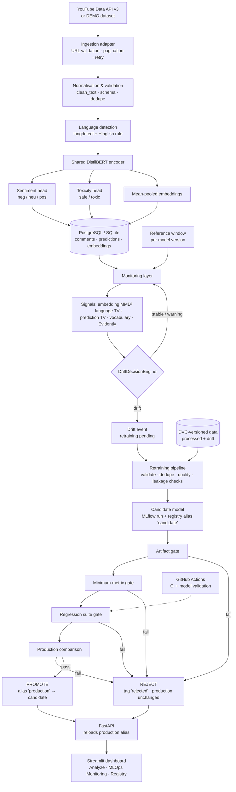

# Architecture

## Lifecycle diagram

## Components

| Layer | Module | Responsibility |
|---|---|---|
| Config | `src/config/settings.py`, `configs/*.yaml` | All tunables in YAML, secrets/URLs in env vars |
| Data | `src/data/` | schemas, cleaning, validation, split, content-hash versioning |
| Ingestion | `src/ingestion/` | `SocialMediaAdapter` → `YouTubeAdapter` (official API), `DemoAdapter` |
| NLP | `src/nlp/` | language detection, multi-task model, batched inference, embeddings |
| Training | `src/training/` | baseline, trainer, `train.py`, MLflow tracking + registry |
| Evaluation | `src/evaluation/` | test-set evaluation, regression suite, `PromotionDecisionEngine` |
| Monitoring | `src/monitoring/` | reference windows, MMD / TV drift, vocabulary, Evidently, `DriftDecisionEngine`, drift simulation data |
| Pipelines | `src/pipeline/` | `analyze` (on demand), `monitor` (polling worker), `retrain`, `model_service` |
| Storage | `src/database/` | SQLAlchemy models + repository (Postgres in compose, SQLite locally) |
| Reporting | `src/reporting/` | analytics, executive summary, HTML/Markdown report |
| Serving | `src/api/` | FastAPI routes (thin adapters over the pipeline layer) |
| UI | `dashboard/` | Streamlit; talks to the API only |

## Key design decisions

- **One service layer.** CLI, API and dashboard all go through `src/pipeline/*`; the dashboard
  never loads a model itself.
- **MLflow is the source of truth for models.** Serving resolves the `production` alias; files on disk
  (`artifacts/model_cache/v<N>`) are only a cache of registry versions.
- **The reference distribution belongs to the model.** Each model version has its own reference window
  embedded by that model; after a drift-triggered retrain the model ships `reference_texts.json`
  (50% historical, 50% recent) so monitoring measures change relative to what it was trained on.
- **Drift never deploys.** A drift event only sets `retraining_status=pending`; the retraining pipeline
  must pass four gates before the `production` alias moves.
- **No queue infrastructure.** Monitoring is a polling thread inside the API process (configurable
  interval, default 300 s); new comments are detected via stored comment ids.
- **Embeddings in the relational DB** as float16 bytes (1.5 KB each) — enough for windowed drift
  statistics without a vector database.

## Traceability

`prediction → predictions.model_version → registry version (tags run_id, dataset_version, git_commit) →
MLflow run (params, metrics, artifacts, lineage tags) → dvc.lock / data manifest → git commit`.
`dataset_version` for retrained models is `<processed hash>+drift:<drift data hash>`.
